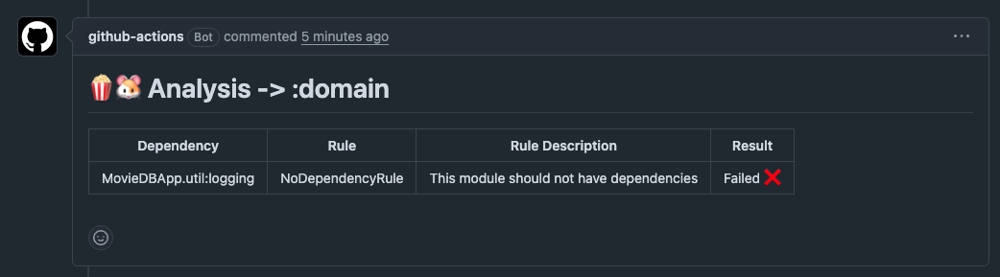

# Automating PopcornGP with GitHub CI/CD

To run PopcornGP architecture validation in your CI pipeline, use the custom composite action:

```yaml
- name: Run Popcorn
  uses: CodandoTV/popcorn-guineapig/.github/actions/popcorn@main
  with:
    working-directory: ./src
    modules: ":app,:core:network" # optional; omit to evaluate all modules
```

## Running only affected modules

!!!note "Module selection available >= 3.3.0"
    The action's `modules` input requires PopcornGP `3.3.0` or later.

On large builds, pass the Gradle project paths of the modules touched by the pull request through the action's `modules` input:

```yaml
- name: Run Popcorn
  uses: CodandoTV/popcorn-guineapig/.github/actions/popcorn@main
  with:
    working-directory: ./src
    modules: ":feature:login,:core:network"
```

The action forwards the value as `--modules=...` to `popcornParent`. The error report will contain only the evaluated modules. If `modules` is omitted or empty, all modules are evaluated. See [Evaluating only selected modules](./1-getting-started.md#evaluating-only-selected-modules) for path syntax and behavior.

## Prerequisites
- Gradle project with the PopcornGP plugin (https://github.com/CodandoTV/popcorn-guineapig) applied and configured
- Gradlew present in the specified working directory
- Java setup

## What it does

1. Runs `./gradlew popcornParent -PerrorReportEnabled`
2. On failure (violations found): reads `build/reports/popcornguineapig/errorReport.md` and posts it as a comment
3. On success (no violations): deletes any previous module-analysis-report comment from the PR

The error reports looks like:



In this example, the domain module has a violation because it depends on a module called 
`util:logging`, while the popcorn rule defines that the module should not have any dependencies.

```kotlin
popcornGuineapigParentConfig {
    type = ProjectType.KMP

    children = listOf(
        ..
        PopcornChildConfiguration(
            moduleNameRegex = ":domain",
            rules = listOf(
                NoDependencyRule(),
            ),
        ),
        ...
    )
}
```
